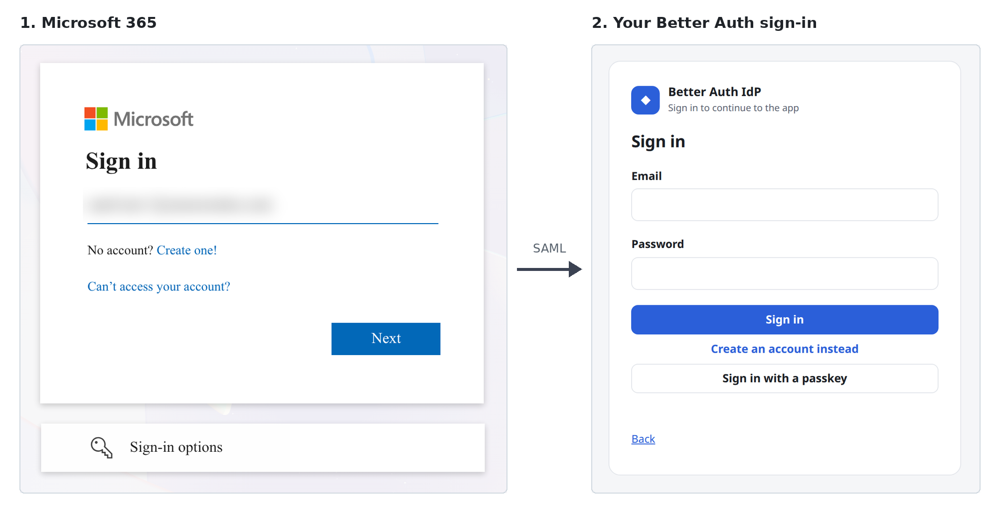
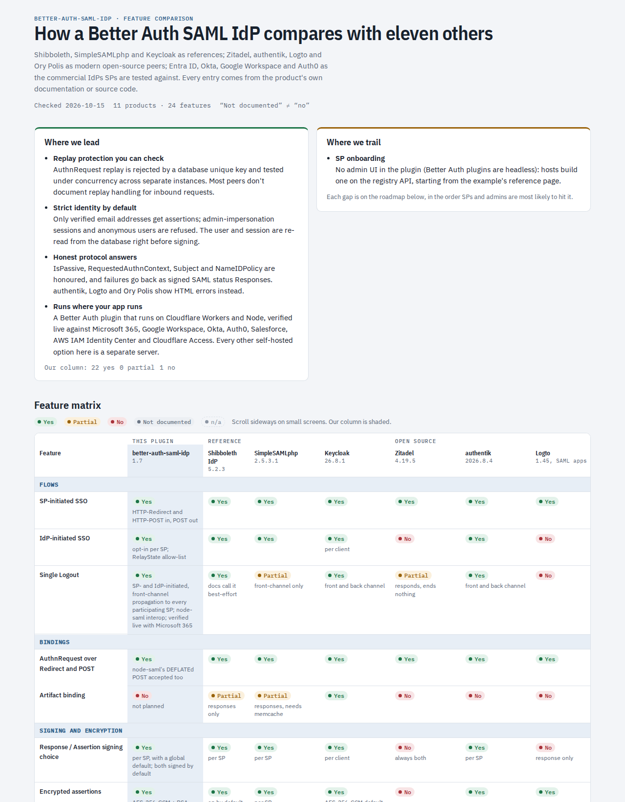

# better-auth-saml-idp

Turn your [Better Auth](https://www.better-auth.com) server into a **SAML 2.0 Identity Provider**, and sign your users in to Microsoft 365, Google Workspace, Okta, Salesforce, AWS and other SAML 2.0 service providers. It's a Better Auth plugin, not a separate server: it runs on **Cloudflare Workers** and **Node 22+**, with no Java and no native binaries.

[](https://github.com/mmcintosh/better-auth-saml-idp/actions/workflows/ci.yml)
[](https://www.npmjs.com/package/better-auth-saml-idp)
[](https://www.better-auth.com)
[](docs/guide/README.md)
[](LICENSE)


**Try it:** the [example IdP](https://better-auth-saml-idp-example.mmcintosh-f61.workers.dev/) (Workers + Hono + D1) signs users in to Microsoft 365, AWS IAM Identity Center, Cloudflare Access, Okta, Auth0 and Salesforce, verified live.

[](docs/sp-microsoft-365.md)

📖 **[Read the guide](docs/guide/README.md)** for everything this page leaves out: every option, every error code, the security controls, Single Logout, Cloudflare Workers, the CLI and troubleshooting.

> **Unofficial community plugin.** Not affiliated with or endorsed by Better Auth. Stable 1.x on npm, following [semantic versioning](docs/guide/versioning.md); the [CHANGELOG](CHANGELOG.md) says what changed in each release and why.

## ✨ Features

- 🔐 **SAML 2.0 single sign-on**: SP-initiated over HTTP-Redirect and HTTP-POST, and IdP-initiated as an opt-in per SP.
- ✍️ **Signed and encrypted**: RSA-SHA256 signatures, AES-256-GCM encryption per SP, zero-downtime key rotation, or a key the plugin [makes, stores and rotates](docs/guide/signing-and-encryption.md#a-key-the-plugin-manages) itself (`signing: { managed: true }`).
- 🛡️ **Hardened input**: every message checked against the OASIS schemas (libxml2 in WebAssembly, on Workers too), defences against XML signature wrapping, and replay protection by a database unique key. Fuzzed on every CI run.
- 👤 **Strict identity**: only verified emails get assertions, impersonated and anonymous sessions are refused, and the user and session are re-read right before signing.
- 🪜 **Step-up MFA and your own rules**: SPs that ask for more send the user back to sign in again ([flows](docs/guide/flows.md#requestedauthncontext)), and a per-SP `authorize` hook can deny with a reason.
- 🚪 **Single Logout** in both directions, and `onSessionEnded` names the SPs still signed in when a session ends without it ([guide](docs/guide/single-logout.md)).
- 🗂️ **SPs at runtime**: an admin API that logs every change, SPs from their metadata, and certificates kept current from a metadata URL ([guide](docs/guide/service-providers.md)).
- 🏢 **Better Auth native**: organization-scoped SPs, an [IdP identity per organization](docs/guide/multi-tenant.md), admin-plugin permissions, a typed client plugin, and tables from `npx auth generate`. With `@better-auth/sso` in the same app it's an [identity broker](docs/guide/better-auth-sso.md#one-app-both-roles-an-identity-broker).
- 🎟️ **Assertions for OAuth tokens**: an agent can trade an assertion for tokens once, the flow MCP's Enterprise-Managed Authorization uses ([guide](docs/guide/token-exchange.md)).
- 📈 **Observability**: event callbacks for audit trails and SIEM, and an optional audit-log table ([guide](docs/guide/observability.md)).
- 🧰 **A CLI** that inspects metadata, decodes captured messages, smoke-tests a deployment and generates keys ([guide](docs/guide/cli.md)).
- 🗄️ **Your database and runtime**: PostgreSQL, MySQL, MongoDB, SQLite and Cloudflare D1, through Kysely, Drizzle and Prisma, all in CI. Workers and Node run the whole suite; Bun and Deno a smoke test. [Benchmarked on Workers and D1](docs/benchmark.md).

## ⚡ Quick Start

```bash
npm install better-auth-saml-idp
npx better-auth-saml-idp keygen --cert-out idp.crt --key-out idp.key   # signing key (mode 0600) and certificate
```

Add the plugin to your Better Auth config, with the key and certificate loaded from your secret store:

```ts
import { betterAuth } from "better-auth";
import { samlIdp } from "better-auth-saml-idp";

export const auth = betterAuth({
  // database, emailAndPassword, … as you have them
  plugins: [
    samlIdp({
      entityId: "https://auth.example.com/api/auth/saml2/idp",
      baseURL: "https://auth.example.com",
      loginPage: "/sign-in", // your sign-in page; it sends users back to callbackURL
      signing: {
        privateKey: process.env.SAML_IDP_PRIVATE_KEY!,
        certificate: process.env.SAML_IDP_CERT!,
      },
      serviceProviders: [
        {
          id: "my-app",
          entityId: "<the SP's entity ID>",
          acsUrls: ["<the SP's ACS URL>"],
          attributes: { email: "email" },
        },
      ],
    }),
  ],
});
```

```bash
npx auth migrate   # create the tables (Drizzle or Prisma: npx auth generate, then your migration)

# Check what SPs will see, turn an SP's metadata into a serviceProviders entry, then run the smoke test:
npx better-auth-saml-idp inspect https://auth.example.com
npx better-auth-saml-idp sp-from-metadata https://sp.example.com/saml/metadata --id my-app
npx better-auth-saml-idp smoke https://auth.example.com --sp <the SP's entity ID>
```

Then give the SP your metadata URL, `https://auth.example.com/api/auth/saml2/idp/metadata`. The [getting started guide](docs/guide/getting-started.md) walks through each step, including the sign-in page and the defaults to know about.

**On Cloudflare Workers,** put `samlIdp()` inside `withCloudflare`'s second argument: a `plugins: [...]` next to `...withCloudflare(...)` replaces the Cloudflare plugin and silently disables its storage validation. Or skip the key step with `signing: { managed: true }`. See [Cloudflare Workers](docs/guide/cloudflare-workers.md).

**Examples:** [Workers + Hono + D1](examples/workers-hono/README.md) (a complete, deployable IdP, the one running the demo), [Next.js](examples/nextjs/README.md) on Node, and [Workers + Neon](examples/workers-neon/README.md) on Postgres through Hyperdrive.

### Requirements

- `better-auth` and `@better-auth/core` `>=1.7.8 <1.8.0` (peer dependencies). Better Auth 1.7.7 fixed three security advisories, a critical Magic Link account takeover among them, and 1.7.8 a SAML replay check in `@better-auth/sso`; see [versioning](docs/guide/versioning.md#better-auth-compatibility).
- A real database. Replay protection depends on UNIQUE constraints, which Better Auth's in-memory adapter doesn't enforce.
- With secondary storage (for example KV): `verification: { storeInDatabase: true }`. On Workers also `rateLimit: { storage: "database" }`, `better-auth-cloudflare` and the `nodejs_compat` flag.

## ✅ Verified with

Live tests are run by hand; each has its date and evidence in [DECISIONS.md](DECISIONS.md).

| Service provider | What was verified | Setup guide |
|---|---|---|
| Microsoft 365 (Entra ID federation) | Sign-in to My Apps with a persistent NameID; Microsoft took the IdP's MFA claim; signing out at Microsoft ended the IdP session | [guide](docs/sp-microsoft-365.md) |
| Google Workspace | Sign-in to Google, with users created and suspended by [better-auth-scim-provisioning](https://www.npmjs.com/package/better-auth-scim-provisioning) | [guide](docs/sp-google-workspace.md) |
| Okta | Signed requests, plain and encrypted assertions, SP stored in the registry | [guide](docs/sp-okta.md) |
| Auth0 | Signed requests over Redirect and POST, encrypted assertions | [guide](docs/sp-auth0.md) |
| Salesforce | Signed requests required, NameID matched to the Federation ID, Single Logout both ways | [guide](docs/sp-salesforce.md) |
| AWS IAM Identity Center | The access portal and the AWS console in a permission set | [guide](docs/sp-aws-iam-identity-center.md) |
| Cloudflare Access | Signed requests, encrypted assertions, metadata refresh, key rotation | [guide](docs/sp-cloudflare-access.md) |
| HubSpot | Guide written, not yet run live | [guide](docs/hubspot.md) |

**In CI:** Keycloak 26.8 and SimpleSAMLphp 2.5 in real Chromium over HTTPS; node-saml, samlify and `@better-auth/sso` on Node and workerd, including an identity broker; PostgreSQL 17, MySQL 8.4, MongoDB 8.2, SQLite and D1, through Kysely, Drizzle and Prisma. [Testing with other SPs](docs/testing-with-sps.md) covers the rest.

## 📚 Documentation

| To… | Read |
|---|---|
| Set it up step by step | [Getting started](docs/guide/getting-started.md) |
| See every option | [Options](docs/guide/options.md) |
| Add SPs: in code, from metadata, at runtime | [Service providers](docs/guide/service-providers.md) |
| Map attributes and NameIDs, limit SPs to organizations, write access rules | [Users and access](docs/guide/users-and-access.md) |
| Choose what's signed, encrypt assertions, rotate keys | [Signing and encryption](docs/guide/signing-and-encryption.md), [key rotation](docs/key-rotation.md) |
| Understand the endpoints and flows, IdP-initiated SSO, step-up | [Flows](docs/guide/flows.md) |
| Turn on Single Logout | [Single Logout](docs/guide/single-logout.md) |
| Give each organization its own IdP | [Multi-tenant](docs/guide/multi-tenant.md) |
| Provision accounts at the SPs too | [Sign-in and provisioning](docs/guide/provisioning.md) |
| Fix an error | [Errors](docs/guide/errors.md), [troubleshooting](docs/guide/troubleshooting.md) |
| Check the security model | [Security controls](docs/guide/security.md), [threat model](docs/security.md) |

The [guide's index](docs/guide/README.md) lists every page, including databases, schema, observability, the CLI and `@better-auth/sso` interop.

## 📊 How it compares

A feature-by-feature comparison with Shibboleth, SimpleSAMLphp, Keycloak, Zitadel, authentik, Logto, Ory Polis, Entra ID, Okta, Google Workspace and Auth0, with sources: **[interactive comparison](https://mmcintosh.github.io/better-auth-saml-idp/comparison/)** (or [docs/comparison.md](docs/comparison.md)).

[](https://mmcintosh.github.io/better-auth-saml-idp/comparison/)

<!-- roadmap:start (generated by scripts/comparison/gen.py) -->
## 🧭 What's next

The 1.x line covers everything on the [roadmap](https://mmcintosh.github.io/better-auth-saml-idp/comparison/#roadmap) derived from a feature comparison with eleven other SAML identity providers (checked 2026-09-25).

**Not planned:**

- 🚫 **Artifact binding**: Of the products compared, only Keycloak supports it fully (Shibboleth and SimpleSAMLphp for responses); no target SP needs it.
- 🚫 **Admin UI in the plugin**: Better Auth plugins are headless; hosts build their own UI on the registry API, and the example has a reference page to copy.

What shipped in each release is in the [CHANGELOG](CHANGELOG.md).
<!-- roadmap:end -->

## 🔒 Security

[](https://scorecard.dev/viewer/?uri=github.com/mmcintosh/better-auth-saml-idp)
[](https://www.bestpractices.dev/projects/15268)
[](https://socket.dev/npm/package/better-auth-saml-idp)
[](https://github.com/mmcintosh/better-auth-saml-idp/actions/workflows/codeql.yml)

- [docs/security.md](docs/security.md): the threat model, what your host must do (don't use KV for sessions; leave `cookieCache` off), and known limitations.
- [DECISIONS.md](DECISIONS.md): every security-relevant design decision, with its tests and mutation proofs.
- [SECURITY.md](SECURITY.md): how to report a vulnerability privately (not in a public issue), and the supply chain: actions pinned by SHA, CodeQL, dependency audits, OSV-Scanner, OpenSSF Scorecard, and npm provenance and a CycloneDX SBOM with every release.

## 🧪 Development

```bash
pnpm test          # Node (node:sqlite) + workerd (D1/Drizzle, validateSchema on)
pnpm test:wasm     # the libxml2 WASM validator, Node + workerd
pnpm e2e           # Playwright + Chromium: Keycloak, SimpleSAMLphp (Docker) and a node-saml SP
pnpm lint && pnpm typecheck && pnpm pack:check
```

CI runs these on Node 24 with Better Auth 1.7.8 and the latest 1.7.x, and on Node 22 with 1.7.8, plus a gitleaks scan, the database matrix and the Next.js example. [CONTRIBUTING.md](CONTRIBUTING.md) has the rest.

## License and contributing

MIT © Mark McIntosh. Third-party components (libxml2 in `wasm/xsd.wasm`, and the OASIS/W3C schemas) are listed in [THIRD_PARTY_NOTICES.md](THIRD_PARTY_NOTICES.md).

Contributions are welcome: bug reports, [SP interop reports](https://github.com/mmcintosh/better-auth-saml-idp/issues/new?template=sp-interop.yml) (especially "it works with X"), fixes and features. For anything significant, please open an issue first; see [CONTRIBUTING.md](CONTRIBUTING.md). If the plugin is useful to you, a ⭐ helps others find it.
